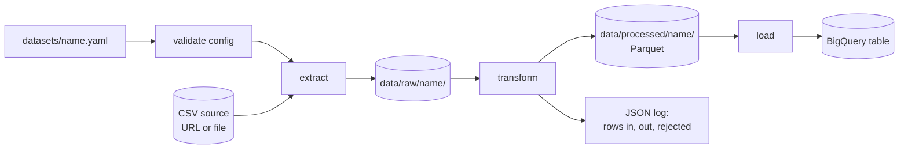

# config-driven-etl

A generic batch ETL pipeline: any public open-data CSV is extracted, cleaned
and transformed with Polars, written as Parquet, and loaded into Google
BigQuery. Each dataset is described by a YAML file; adding a dataset means
adding a file, not writing code.

## Architecture



- **extract**: downloads `source.url` (skipped when unchanged) or copies
  `source.path`, and reads every column as a string.
- **transform**: pure functions on a Polars `LazyFrame`: rename and select
  columns, cast types, then the `nullable`, `min` / `max` and
  `deduplicate_on` rules. Rejected rows are counted per reason and logged.
- **load**: writes snappy Parquet, verifies it, then replaces the BigQuery
  table data with a load job (`WRITE_TRUNCATE`). The schema, partitioning
  and clustering come from the config; re-running gives the same table.

Each stage logs one JSON line to stderr. Exit codes per error category are
listed by `python -m config_driven_etl --help`.

## Setup

Requires Python 3.12 and a Google Cloud project with a BigQuery dataset;
the free [BigQuery sandbox](https://cloud.google.com/bigquery/docs/sandbox)
is enough.

```
pip install -e ".[dev]"
cp .env.example .env        # set GCP_PROJECT_ID and BQ_DATASET
gcloud auth application-default login
```

## Run

```
python -m config_driven_etl validate datasets
python -m config_driven_etl run datasets/usgs_earthquakes.yaml
```

`extract`, `transform` and `load` run single stages. With Docker, settings
come from environment variables and credentials are mounted read-only:

```
docker build -t config-driven-etl .
docker run --rm \
  -e GCP_PROJECT_ID=<project> -e BQ_DATASET=<dataset> \
  -e GOOGLE_APPLICATION_CREDENTIALS=/secrets/adc.json \
  -v <path to credentials json>:/secrets/adc.json:ro \
  -v <host data dir>:/data \
  config-driven-etl run datasets/usgs_earthquakes.yaml
```

Sample query on the loaded earthquakes:

```sql
SELECT DATE(time) AS day, COUNT(*) AS events, MAX(mag) AS max_mag
FROM `<project>.<dataset>.usgs_earthquakes`
WHERE time >= DATETIME_SUB(CURRENT_DATETIME(), INTERVAL 7 DAY)
  AND type = 'earthquake'
GROUP BY day
ORDER BY day DESC;
```

**Sandbox expiry**: in the BigQuery sandbox, tables are deleted 60 days
after creation and partitions older than 60 days are dropped. The next run
recreates a deleted table. Rows dated more than 60 days ago in a
partitioned table are dropped by BigQuery, and the load fails its row
count check.

## Adding a dataset

1. Copy `datasets/example.yaml`, which documents every option, to
   `datasets/<name>.yaml`.
2. Set the source, one entry per column to keep (CSV header, target name,
   type, optional rules), the dedup keys and the BigQuery target.
3. Check it: `python -m config_driven_etl validate datasets/<name>.yaml`.
4. Run it: `python -m config_driven_etl run datasets/<name>.yaml`.

No code changes are needed. Dataset files are committed, so they must not
contain secrets.

## Test

```
ruff check . && ruff format --check .
pytest tests/unit tests/system --cov=config_driven_etl
pytest -m gcp              # real BigQuery sandbox, needs .env and credentials
```

## Datasets

| Dataset | Publisher | Source | License |
|---------|-----------|--------|---------|
| Earthquakes, past 30 days | U.S. Geological Survey | [all_month.csv](https://earthquake.usgs.gov/earthquakes/feed/v1.0/summary/all_month.csv) | [Public domain](https://www.usgs.gov/information-policies-and-instructions/copyrights-and-credits) |
| Electric Vehicle Population | Washington State Department of Licensing | [data.wa.gov](https://data.wa.gov/d/f6w7-q2d2) | [ODbL 1.0](https://opendatacommons.org/licenses/odbl/1-0/) |
| 2018 Central Park Squirrel Census | NYC Open Data | [data.cityofnewyork.us](https://data.cityofnewyork.us/d/vfnx-vebw) | [NYC Open Data Terms of Use](https://www.nyc.gov/main/terms-of-use) |

## License

[MIT](LICENSE)
